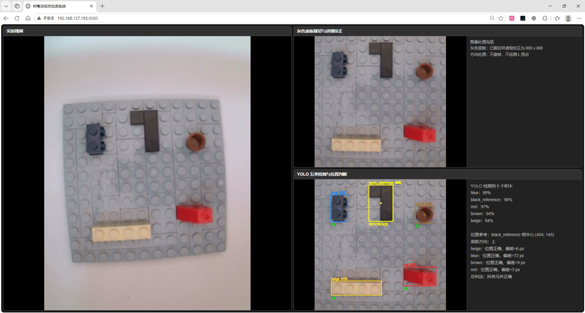
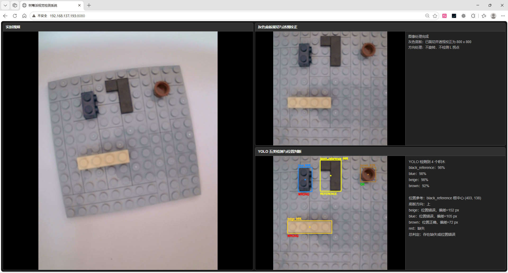
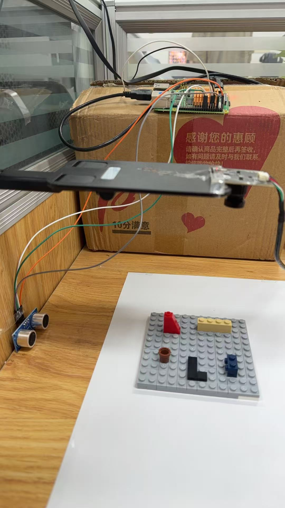
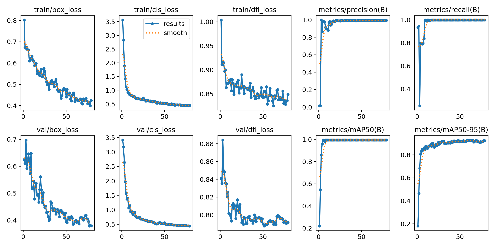
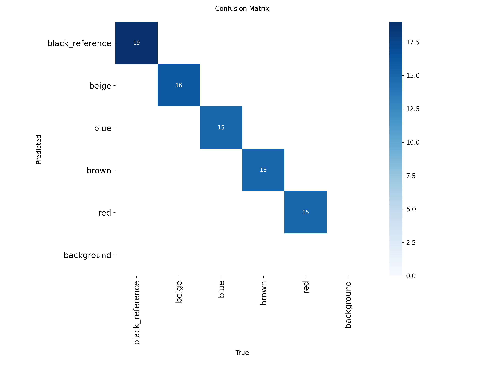

# 基于树莓派和YOLOv8n的视觉检测系统

这是一个运行在树莓派上的小型视觉检测项目。系统会通过超声波触发拍照，使用OpenCV校正灰色底板，再通过YOLOv8n识别五块积木，最后根据黑色参考块判断其他积木有没有缺失或位置错误。

## 效果展示



网页同时显示实时画面、灰板透视图和YOLO检测结果。



检测框、类别、置信度和位置判断会直接显示在页面中。



树莓派、摄像头和超声波组成的实物检测装置。

## 这个项目能做什么

- 显示USB摄像头实时画面。
- 超声波测距小于12 cm时自动触发检测。
- 使用OpenCV识别灰色底板并做透视校正。
- 使用YOLOv8n检测五类积木。
- 使用黑色积木作为位置参考。
- 判断彩色积木是否缺失或位置错误。
- 在网页中显示实时视频、检测图和文字结果。
- 在树莓派C++程序中使用ONNX Runtime推理。

## 整体流程

```text
原图
→ 灰色底板检测
→ 透视校正到800×800
→ YOLOv8n检测
→ 黑色参考块相对位置判断
→ 网页显示结果
```

电脑端的数据准备流程：

```text
图片预处理
→ 人工标注
→ YOLO训练
→ 导出ONNX
```

## 检测类别

| ID | 类别 |
|---:|---|
| 0 | black_reference |
| 1 | beige |
| 2 | blue |
| 3 | brown |
| 4 | red |

## 模型结果

| 指标 | 结果 |
|---|---:|
| Precision | 0.99486 |
| Recall | 1.00000 |
| mAP50 | 0.99500 |
| mAP50-95 | 0.92151 |

这些结果来自当前19张验证图片，数据量还比较小，实际效果仍需要以树莓派现场测试为准。





## 项目目录

```text
raspberry-pi-lego-vision-inspection/
├── python/
├── raspberry_pi/
├── dataset/
├── models/
├── results/
├── docs/images/
├── README.md
└── .gitignore
```

## Windows端使用

1. 创建Python环境并安装依赖：

   ```powershell
   pip install -r python/requirements.txt
   ```

2. 检测灰色底板并生成800×800透视图：

   ```powershell
   python python/preprocessing/run_board_crop_only.py --root dataset --clean
   ```

3. 启动人工标注程序：

   ```powershell
   python python/labeling/manual_label_main.py
   ```

4. 训练YOLOv8n、验证并导出ONNX：

   ```powershell
   python python/training/train_model.py
   ```

训练脚本会检查裁切图片和标签是否一一对应，并在 `dataset/yolo_dataset_generated` 中生成训练/验证划分。训练结果写入 `runs`，最终ONNX写入 `models`。

## 树莓派端使用

先准备OpenCV、libgpiod C++库和AArch64版ONNX Runtime，然后执行：

```bash
cd raspberry_pi
cmake -S . -B build -DONNXRUNTIME_ROOT=/path/to/onnxruntime
cmake --build build -j2
./build/gpio_test
```

程序默认读取 `../models/lego_yolov8n_manual.onnx`，也可以手动指定模型：

```bash
./build/gpio_test /path/to/model.onnx
```

网页默认端口是8080：

```text
http://树莓派IP:8080
```

## 当前检测规则

- `black_reference` 作为位置参考。
- `beige`、`blue`、`brown` 和 `red` 必须被检测到。
- 使用检测框中心点的相对坐标判断位置。
- 当前代码采用统一100像素径向阈值。
- 后续可以改成不同类别使用不同阈值。

## 当前限制

- 数据量还比较少。
- 当前没有独立拍摄批次测试集。
- 位置规则目前比较简单。
- 光线和摄像头安装变化可能影响结果。
- 摄像头方向改变后需要修改固定旋转设置。
- 目前主要判断缺件和位置错误。


## 树莓派CPU推理实测（2026-10-16）

正式C++源码取消显式ORT 2线程，使用默认自动线程配置；保留Extended、默认自旋、Sequential和CPU EP。FP32模型、640×640输入、OpenCV参数、底板形态学核及检测规则保持原样。

Raspberry Pi 4B（4核Cortex-A72，Debian 13.4，ORT 1.26.0，OpenCV 4.10.0），固定15张图片，每进程预热20次、正式100次，普通延迟与资源监控分开运行：

| 离线C++检测链路 | 原2线程 | 默认自动线程 |
|---|---:|---:|
| ORT Run平均 / P95（ms） | 608.09 / 612.15 | 443.75 / 446.41 |
| 含底板校正的完整流程平均 / P95（ms） | 1080.76 / 1089.00 | 917.52 / 924.92 |
| 独立监控进程CPU均值（单核100%） | 160.17% | 247.62% |
| 独立监控进程RSS均值（MiB） | 154.62 | 153.30 |

推理平均延迟降低27.03%，完整流程平均延迟降低15.10%。15张图片的底板定位、类别、检测框和最终业务判断一致；原始FP32输出Tensor在记录的误差阈值内一致。正式程序编译成功，离线验收通过。

详细环境、参数对照、CPU与温度代价、验证方法及原始CSV见[性能优化与离线验收记录](raspberry_pi/docs/performance_optimization.md)；复现入口见[离线Benchmark](raspberry_pi/benchmarks/acceptance/README.md)。

本次修改、验收数据及GitHub提交见[最终报告](FINAL_REPORT.md)。
